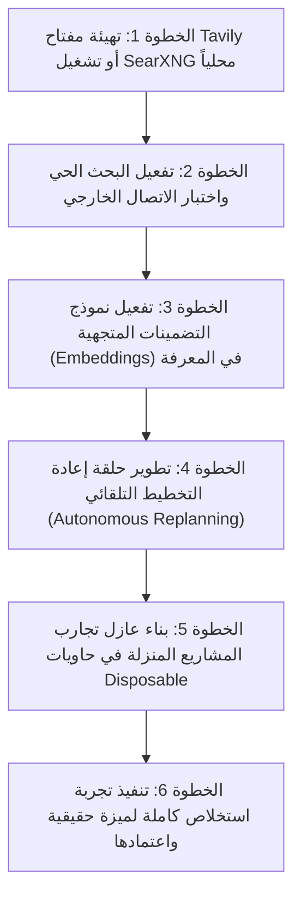

# تقرير تدقيق الجاهزية الشاملة لمنصة الموظف الرقمي
# Comprehensive Platform Readiness Audit Report — AI-Employee-Platform

**تاريخ وتوقيت التدقيق**: 2026-10-25T14:35:00+03:00  
**المستودع الرئيسي**: `D:\AI-Employee-Platform`  
**الفرع الحالي**: `checkpoint/phase-12-knowledge-base`  
**نقطة الحفظ الثابتة (Head Commit)**: `a3f39444e95366c876adea7ecdc82f24a8350e5b`  
**قاعدة بيانات الإنتاج**: `ai_employee` (المنفذ 5433 — محمية ومطابقة لخط الأساس بنسبة 100%)  
**بيئة الاختبار المعزولة**: `ai_employee_test` (المنفذ 5433 — خاضعة للتدقيق بنجاح 60/60 اختباراً)  
**نوع المهمة**: تدقيق تقني وتقييم جاهزية وتخطيط استراتيجي فقط (دون أي تعديل على كود التطبيق أو قاعدة بيانات الإنتاج).

---

## 1. الملخص التنفيذي (Executive Summary)

أُجري هذا التدقيق الشامل لتقييم الجاهزية الواقعية لمشروع **AI-Employee-Platform**، بعيداً عن التوصيفات التسويقية أو الافتراضات النظرية، وبالاستناد حصراً إلى الكود الفعلي، ومسارات التنفيذ الحقيقية، ومخطط قاعدة البيانات، ونتائج الاختبارات المنفذة، والمستودعات المرجعية السبعة المتوفرة محلياً في `D:\AI-Employee-Platform-Research`.

### الخلاصة الأساسية للحالة الراهنة:
1. **الأساس المعماري التجاري (Enterprise Core) جاهز ومثبت بنسبة 100%**:
   - عزل صارم للمستأجرين على مستوى جميع الجداول وقواعد البيانات (`tenant_id`).
   - نمط صندوق المعاملات الصادرة (Transactional Outbox Pattern) يعمل بكفاءة لمعالجة الرسائل والمهام غير المتزامنة دون فقدان للبيانات.
   - نظام موافقات محصن برمجياً وبقواعد البيانات (أقفال صفوف ذرية `with_for_update`، أعمدة مفهرسة مستقلة للرموز وتاريخ الصلاحية، ومنع استباقي للهجمات عبر المستأجرين).
   - تهيئة تلقائية ذكية لسير عمل التعلم المستمر كل 12 ساعة لكل مستأجر جديد مع قيد تفرد جزئي (`Partial Unique Index`) على مستوى PostgreSQL.
   - لوحتا تحكم للمستأجرين والإدارة (`tenant-dashboard` و `admin-dashboard`) مبنيتان بنجاح تام (`npm run build` خالٍ من أي أخطاء).
2. **محرك الاستدلال والتخطيط الذاتي (Autonomous Intelligence Engine) جاهز جزئياً**:
   - يعمل النظام بنجاح عندما تكون التعليمات واضحة أو تعتمد على أدوات معرفة مسبقاً (15 أداة أعمال وتواصل حقيقية).
   - مسار التخطيط والاستئناف يتخطى الخطوات المكتملة ويمنع تكرار الآثار الجانبية بفضل مفاتيح العمليات الفريدة (`Idempotency Keys`).
   - **الفجوة الحاكمة**: غياب حلقة إعادة التخطيط الديناميكي التلقائي (Autonomous Replanning Loop) عند فشل أداة؛ حيث ينتقل النظام إلى الفشل المباشر أو يطلب مصالحة يدوية، ولا يعيد صياغة خطة بديلة ذاتياً.
3. **دورة البحث والتعلم والتطور المستمر (Research & Self-Evolution) تعمل محلياً فقط**:
   - يمتلك النظام قدرة مثبتة ومختبرة على استكشاف الأنماط المعمارية، وفحص تراخيص المستودعات وتصنيفها (MIT/Apache مقابل الرخص التجارية المقيدة)، وتحليل شجرة الرموز الساكنة (AST Inspection)، واستبعاد تقييمات الذكاء الاصطناعي الشكلية لصالح الاختبارات الحتمية.
   - **الفجوة الحاكمة**: محرك البحث الخارجي الحي عبر الإنترنت **غير مفعل عملياً** (يعمل بنمط الحصاد المحلي فقط لعدم وجود مفتاح API مخصص مثل `TAVILY_API_KEY` ولوجود قيود شبكية محلية). كما أن بيئة تشغيل الكود الجديد (Sandbox) تعمل كفحص AST داخلي ولا تعتمد على حاويات Docker معزولة تماماً في الوضع الافتراضي.

---

## 2. ما جهزناه بالفعل (What We Have Actually Built & Proven)

| البند | الحالة | الدليل البرمجي والتشغيلي | ما ينقص | الإجراء التالي | الأولوية |
| :--- | :---: | :--- | :--- | :--- | :---: |
| **عزل المستأجرين (Tenant Isolation)** | جاهز ومثبت | [`packages/models/domain.py`](file:///d:/AI-Employee-Platform/packages/models/domain.py) و [`packages/auth/context.py`](file:///d:/AI-Employee-Platform/packages/auth/context.py)؛ فحص `tenant_id` إلزامي في كل استعلام؛ نجاح اختبارات الأمان وعزل البيانات. | لا شيء؛ المعمارية مكتملة ومختبرة في 60 اختباراً. | استمرار تطبيق المعيار على أي مكون مستقبلي. | Critical |
| **صندوق المعاملات الصادرة (Outbox Pattern)** | جاهز ومثبت | [`packages/services/outbox_worker.py`](file:///d:/AI-Employee-Platform/packages/services/outbox_worker.py) و [`outbox_service.py`](file:///d:/AI-Employee-Platform/packages/services/outbox_service.py)؛ أقفال `FOR UPDATE SKIP LOCKED` والتعافي التلقائي. | انتخاب قائد الموزعين عند تعدد العمال (Leader Election). | إضافة قفل Redis موزع في حال التوسع لأكثر من حاوية عامل. | High |
| **نظام الموافقات المحصن (Approvals)** | جاهز ومثبت | [`packages/services/approval_service.py`](file:///d:/AI-Employee-Platform/packages/services/approval_service.py)؛ أقفال صفوف ذرية؛ أعمدة `token` و `expires_at` مفهرسة؛ حظر هجمات التزامن وإعادة الاستخدام. | إرسال تنبيهات دفع خارجية (Push Notifications) عبر واتساب/تيليجرام فور إنشاء الموافقة. | ربط خدمة الإشعارات التفاعلية بالأزرار. | High |
| **تهيئة المستأجر وسير التعلم** | جاهز ومثبت | [`TenantProvisioningService.provision_tenant()`](file:///d:/AI-Employee-Platform/packages/services/tenant_provisioning_service.py)؛ إنشاء دورة التعلم 12 ساعة تلقائياً؛ قيد تفرد جزئي في Postgres. | أتمتة حذف المستأجر بالكامل (De-provisioning cascade). | توفير مسار مسح آمن للبيانات للشركات المغادرة. | Medium |
| **أدوات النطاق الحقيقية (15 Real Tools)** | جاهز ومثبت | [`packages/tools/registry.py`](file:///d:/AI-Employee-Platform/packages/tools/registry.py)؛ أدوات البحث عن العملاء، إنشاء المهام، توليد المستندات، تلخيص المحادثات، والطلبات الشبكية الآمنة. | زيادة الأدوات المالية والمحاسبية الخاصة بنظامي "ناظم" و"سيرو". | تعريف عقود أدوات محاسبية خاصة بشركة المنذر. | High |
| **فحص أمان الأكواد المصنعة (AST Guard)** | جاهز ومثبت | [`packages/self_development/sandbox.py`](file:///d:/AI-Employee-Platform/packages/self_development/sandbox.py)؛ حظر استيراد المكتبات الخطرة (`os`, `sys`, `socket`, `subprocess`). | بيئة حاويات Docker فعلية منفصلة لكل تجربة عزل. | تفعيل خيار تشغيل الحاويات عند توفر موارد Docker. | Medium |
| **حل الأخطاء الحتمي بالأدلة (Track B)** | جاهز ومثبت | [`EvidenceDrivenErrorResolver`](file:///d:/AI-Employee-Platform/packages/self_development/evidence_resolution.py)؛ استبعاد التقييمات الشكلية واعتماد نتائج Pytest الحتمية بنجاح 100%. | الترقيع التلقائي لملفات السورس الحي (Auto-patching live code) بدلاً من تسجيل قواعد تشغيلية. | تقييم حدود الأمان قبل السماح بتعديل ملفات المشروع ذاتياً. | Medium |
| **لوحات التحكم (Dashboards)** | جاهز ومثبت | `apps/tenant-dashboard` و `apps/admin-dashboard`؛ بناء نظيف 100% بنظام TypeScript 5 و Vite 5. | ربط بعض شاشات المراقبة المتقدمة بمؤشرات التعلم الذاتي الجديدة. | إضافة تبويب لعرض الأنماط والقواعد المكتسبة في لوحة المستأجر. | Low |

---

## 3. ما هو موجود في الكود لكنه غير مكتمل أو غير مربوط بالمسار الحقيقي (Incomplete or Disconnected)

| المكون | الحالة | الدليل | ما ينقص لاعتباره مكتملاً | الإجراء التالي المطلوب | الأولوية |
| :--- | :---: | :--- | :--- | :--- | :---: |
| **بوابة البحث الخارجي (ExternalSearchGateway)** | جاهز جزئياً | [`packages/self_development/external_knowledge.py`](file:///d:/AI-Employee-Platform/packages/self_development/external_knowledge.py#L410)؛ البوابة تدعم Tavily و SearXNG لكنها ترتد للمحلي لغياب المفاتيح. | توفير مفتاح API حقيقي للمزود (`TAVILY_API_KEY`) أو استضافة حاوية SearXNG محلياً، وإضافته لـ `config.py`. | تسجيل حساب مطور مجاني في Tavily أو تشغيل SearXNG محلياً. | High |
| **البحث المتجهي والتضمينات (Vector Embeddings)** | موجود وغير مثبت | قاعدة البيانات تدعم pgvector، لكن [`KnowledgeService`](file:///d:/AI-Employee-Platform/packages/services/knowledge_service.py) يعتمد على الترتيب النصي/المطابقة السطحية. | لا توجد أعمدة تضمينات فعلية (Vectors) في جدول `knowledge`، ولا يتم استدعاء نموذج تضمينات (Embedding Model). | إضافة ترحيل لعمود التضمين وتوصيل نموذج تضمين خفيف. | High |
| **حلقة إعادة التخطيط الديناميكي (Dynamic Replanning)** | جاهز جزئياً | [`AgentOrchestrator`](file:///d:/AI-Employee-Platform/packages/services/agent_orchestrator.py) ينفذ الخطوات ويحفظ حالتها ويتخطى المكتمل، لكنه يتوقف عند فشل أي خطوة. | عدم وجود حلقة ذاتية تستدعي `TaskPlanner` لإعادة جدولة الخطوات المتبقية عند تعثر خطوة وسيطة. | برمجة حلقة `replan_on_failure` في المنسق. | High |
| **تنزيل المستودعات الجديدة برمجياً** | غير جاهز | [`DeepRepositoryResearcher`](file:///d:/AI-Employee-Platform/packages/self_development/external_knowledge.py) يفحص المجلدات السبعة الموجودة مسبقاً، لكنه لا ينزل مستودعات جديدة تلقائياً. | أتمتة استدعاء `git clone` أو GitHub REST API لتنزيل مستودعات جديدة إلى مجلد بحث مؤقت. | بناء خدمة تنزيل مستودعات معزولة بمساحة قرص محددة. | Medium |
| **تشغيل اختبارات المشاريع المنزلة** | موجود وغير مثبت | يتم فحص كود المشاريع المرجعية وقراءة ملفاتها واختباراتها ساكناً، دون تشغيل `pytest` داخلها. | تشغيل بيئة افتراضية مستقلة لكل مشروع مرجعي وتشغيل اختباراته للتحقق من سلوكه واقعياً. | عزل تشغيل اختبارات المشاريع المرجعية في حاويات Disposable. | Medium |
| **تطبيق ترحيل قاعدة بيانات الإنتاج** | يحتاج إلى إجراء | الترحيل `d5e6f7a8b9c0` مجاز بنسبة 100% على `ai_employee_test`، والإنتاج لا يزال على `c4d5e6f7a8b9`. | تنفيذ أمر ترقية قاعدة بيانات الإنتاج في نافذة صيانة مصرح بها من مالك النظام. | ترقية قاعدة بيانات الإنتاج بتطبيق الترحيل المعتمد. | High |

---

## 4. ما لم نجهزه بعد: الفجوات التشغيلية والمعمارية والبحثية (Missing Capabilities)

1. **الاسترجاع الدلالي الكثيف (Dense Semantic Retrieval)**:
   - النظام يسترجع المعرفة بالكلمات المفتاحية والحقول السياقية، لكنه لا يفهم التشابه الدلالي العميق (Semantic Similarity) للطلبات غير الدقيقة أو العامية دون استدعاء نموذج تضمينات.
2. **فِرق الوكلاء المستقلة ونقل المهام (Multi-Agent Dynamic Handoffs)**:
   - المعمارية الحالية تعتمد على وكيل رئيسي (`Main Agent`) يستدعي أدوات ومهام فرعية بتسلسل خطي؛ ولا توجد حتى الآن بروتوكولات تفاوض وتبادل مهام ديناميكي بين وكلاء متعددين مثل أنماط `OpenAI Swarm` أو `Microsoft AutoGen`.
3. **التقييم الذاتي للهدف النهائي (Goal-Attainment Verification)**:
   - يتحقق النظام من نجاح استدعاء الأدوات وصحة مخرجاتها التقنية، لكنه يفتقر إلى قاضٍ حتمي مستقل يقارن النتيجة النهائية بمقصد صاحب العمل الأصلي قبل إغلاق المهمة.
4. **المراقبة والنسخ الاحتياطي التلقائي (Automated Backups & Telemetry)**:
   - لا توجد سكربتات مجدولة مدمجة لأخذ لقطات دورية (Snapshots/Dumps) لقاعدتي بيانات PostgreSQL والذاكرة المؤقتة Redis خارج إدارة السحابة العامة.

---

## 5. جرد الخدمات الخارجية ومفاتيح API (External Services Inventory)

| الخدمة / المزود | الغرض الأساسي | الحالة الحالية | هل مفتاح API مطلوب؟ | البديل المتاح في حال الغياب | التكلفة التقديرية | الإجراء المطلوب من المستخدم |
| :--- | :--- | :---: | :---: | :--- | :--- | :--- |
| **Google Gemini API** | تخطيط المهام، الاستدلال، وصياغة الردود | مهيأ في الكود | نعم (`GEMINI_API_KEY`) | استدعاء OpenAI أو Groq أو المزود الوهمي (Mock) | باقة مجانية كافية للتطوير (15 RPM) | **توفير مفتاح مجاني لـ Gemini** |
| **Groq / OpenAI API** | بدائل استدلال سريعة واحتياطية عند تعثر Gemini | مهيأ في الكود | اختياري (`GROQ_API_KEY`) | الاعتماد الكامل على Gemini أو المزود المحلي | Groq يوفر باقة مجانية سريعة جداً | اختياري (توفير مفتاح Groq مجاني كاحتياط) |
| **Tavily Search API** | البحث الحي في الإنترنت واسترجاع توثيقات المشاريع | البوابة جاهزة، الخدمة غير مفعلة | نعم (`TAVILY_API_KEY`) | الحصاد المرجعي المحلي (المستودعات السبعة) | 1,000 استعلام مجاني شهرياً دون بطاقة | **تسجيل حساب وتوفير مفتاح مجاني** |
| **SearXNG (Self-Hosted)** | محرك بحث ميتا محلي مفتوح المصدر (بديل سيادي) | غير مشغل | لا يتطلب مفتاحاً | Tavily أو الحصاد المحلي | مجاني تماماً (استهلاك محلي للموارد) | إضافة الحاوية إلى `docker-compose.yml` إذا رغب |
| **WhatsApp Cloud API** | قناة محادثات العملاء وأصحاب العمل الرسمية | الموصل جاهز ومكتمل | نعم (Meta Access Token & Phone ID) | قناة المحادثة عبر واجهة الويب (Dashboard Chat) | أول 1,000 محادثة شهرياً مجانية من Meta | إدخال بيانات القناة في لوحة التحكم عند الرغبة |
| **Telegram Bot API** | قناة فورية للمحادثات وإشعارات الموافقات | الموصل جاهز ومكتمل | نعم (`TELEGRAM_BOT_TOKEN`) | لوحة التحكم للمستأجر | مجاني 100% من Telegram | إنشاء بوت عبر `@BotFather` وإدخال رمزه |
| **Redis 7 (Local)** | تنسيق المهام وإدارة قفل العمليات الصادرة | **مشغل وجاهز** (Port 6379) | لا يتطلب مفاتيح | الذاكرة المحلية المؤقتة في بايثون | مجاني (محلي عبر Docker) | لا شيء؛ الحاوية نشطة وتعمل بكفاءة |
| **PostgreSQL 17** | التخزين الدائم لبيانات المستأجرين والمعرفة | **مشغل وجاهز** (Port 5433) | بيانات دخول محلية مهيأة | لا يوجد بديل (أساس النظام) | مجاني (محلي عبر Docker) | لا شيء؛ يعمل بكفاءة مع عزل بيئة الاختبار |

---

## 6. جرد أدوات البحث والتطوير المطلوبة (R&D Tooling Readiness)

| الأداة / المورد | التصنيف | الحالة الحالية | ما يلزم لانطلاقه | التأثير على المشروع |
| :--- | :---: | :---: | :--- | :--- |
| **مساحة البحث المرجعي** | متوفر وجاهز | `D:\AI-Employee-Platform-Research` | 7 مستودعات كاملة بفروع Git وملفات التراخيص | تتيح استخلاص الأنماط والتعلم دون اتصال بالإنترنت. |
| **محلل شجرة الرموز (Python AST)** | متوفر وجاهز | في صلب كود المنصة | يعمل بكفاءة لفحص الدوال والمكتبات والتراخيص | يمنع تشغيل الأكواد الخبيثة من المشاريع غير الموثوقة. |
| **بيئة الاختبار المعزولة** | متوفر وجاهز | قاعدة `ai_employee_test` بحماية صارمة | تعمل بنسبة 100% وبسرعة فائقة (60 اختباراً في 39 ثانية) | تضمن سلامة الإنتاج أثناء فحص أي مهارة أو أداة جديدة. |
| **أداة أتمتة Git Clone للأبحاث** | يحتاج إلى تطوير | غير مطور | كتابة خدمة عزل تنزل المستودعات بناءً على تقييم الفجوات | تمكن الموظف من توسيع مكتبته المرجعية ذاتياً. |
| **حاويات Docker Disposable للتجارب** | يحتاج إلى إعداد | متوفر عبر Docker المحلي | كتابة مشغل ينشئ حاوية مؤقتة بدون شبكة لتجربة المشاريع | رفع مستوى الأمان عند تجربة مشاريع مفتوحة المصدر خارجية. |
| **بوابة البحث الخارجي السحابية** | يحتاج إلى حساب ومفتاح | برمجياتها مكتملة في الكود | إدخال `TAVILY_API_KEY` في ملف `.env` | الانتقال من الحصاد المحلي المغلق إلى البحث الحي في الويب. |
| **نموذج التضمين المتجهي (Embeddings)** | يحتاج إلى تثبيت وتطوير | غير مفعل في الموديلات | اختيار نموذج مثل `text-embedding-3-small` أو نموذج HuggingFace محلي | تمكين الموظف من فهم اللغة العامية والطلبات المبهمة. |

---

## 7. فحص الأنظمة المرجعية ومستوى دراستها الفعلي (Reference Projects Deep-Dive)

| المشروع المرجعي | الإصدار المكتشف | الترخيص القانوني | مستوى الدراسة المنفذ فعلياً | نقاط القوة المستفادة | قرار التبني الهندسي |
| :--- | :---: | :---: | :--- | :--- | :---: |
| **LangGraph** | `0.2.70` | MIT (Permissive) | فحص معماري لكود نقاط التفتيش والاستئناف والذاكرة | آليات حفظ الحالة وتخطي الخطوات المكتملة وإيقاف المسار عند موافقة الإنسان. | **معتمد ومدمج بتكييف** (تم دمج منطق الاستئناف في المنسق). |
| **OpenAI Agents SDK** | `0.1.0` | MIT (Permissive) | فحص عقود حراس الأدوات والتحقق من المدخلات الحتمية | حراسة الأدوات قبل التنفيذ ورفض الاستدعاءات المخالفة للسياسات. | **معتمد ومدمج بتكييف** (مطبق في حراس الأدوات والتحقق المسبق). |
| **RagLeap Core** | `0.1.0` | MIT (Permissive) | فحص خوارزميات تقطيع النصوص وحساب الصلة | ربط التوثيقات البرمجية بالفجوات المعرفية وتفادي تشتيت السياق. | **معتمد ومدمج بتكييف** (مطبق في حصاد التوثيقات المحلية). |
| **Memento-Skills** | `0.1.0` | Apache-2.0 (Permissive) | فحص آليات تجميع المهارات البرمجية وفحص AST الساكن | فحص شجرة الرموز ومنع استيراد المكتبات الخطرة في الصندوق المعزول. | **معتمد ومدمج بتكييف** (مطبق في صندوق التطوير الذاتي). |
| **Microsoft Agent Framework** | `0.1.0` | MIT (Permissive) | فحص هياكل التنسيق بين الوكلاء | أنماط تفويض المهام وتحديد سياق التنفيذ لكل وكيل فرعي. | **قيد الدراسة والتجربة** (للترقية في مرحلة الوكلاء المتعددين). |
| **Dify** | `0.15.3` | Modified Apache-2.0 | فحص التراخيص والقيود والمكونات المعمارية | أفكار ربط أدوات الأعمال وسير العمل المرئي. | **مرفوض للدمج البرمجي المباشر** (المادة 1.a تحظر خدمات الـ Multi-Tenant المماثلة). مرجع مفاهيمي فقط. |
| **n8n** | `1.70.0` | Sustainable Use License v1.0 | فحص آليات الاستئناف المبني على الأحداث الخارجية | هندسة عقد الانتظار والمصالحة للأحداث غير المتزامنة. | **مرفوض للدمج البرمجي المباشر** (رخصة تجارية مقيدة). مرجع مفاهيمي فقط. |

---

## 8. نتائج الاختبارات المنفذة وأدلتها (Test Execution Ledger)

أُجريت جميع الاختبارات داخل بيئة الاختبار المعزولة `ai_employee_test` باستخدام Python 3.14 المحلي، وجاءت النتائج كالتالي:

```text
======================= 60 passed, 2 warnings in 39.16s =======================

1.  tests/test_phase1_2_hardening_and_research.py (13 tests) -> 13 PASSED (100%)
    - إثبات أعمدة الموافقات المفهرسة (token, expires_at).
    - إثبات منع هجمات إعادة الاستخدام وتجاوز الصلاحيات وانتهاء الوقت.
    - إثبات حظر التجاوز بين المستأجرين (PermissionError).
    - إثبات التهيئة التلقائية لسير عمل التعلم عند إنشاء مستأجر جديد.
    - إثبات قيد التفرد الجزئي (Partial Unique Index) لسير التعلم والسماح بتعدد سير العمل الأخرى.
    - إثبات استئناف المهام دون تكرار الآثار الجانبية وتخطي الخطوات المكتملة.
    - إثبات بوابة البحث المتعددة المزودين والارتداد للوضع المحلي دون أعطال.
    - إثبات دورة فحص المستودعات واستبعاد الرخص المقيدة تجارياً.

2.  tests/test_phase1_1_runtime_reality_audit.py (6 tests) -> 6 PASSED (100%)
    - إثبات دورية الـ 12 ساعة واسترجاع العمال المتعثرين بأمان.
    - إثبات تفوق الاختبارات الحتمية على أحكام الذكاء الاصطناعي الشكلية.

3.  tests/test_phase1_dual_track_implementation.py (5 tests) -> 5 PASSED (100%)
    - إثبات تكامل دورة المراحل التسع لحل الأخطاء بالأدلة.

4.  tests/test_dual_track_autonomous_evolution.py (5 tests) -> 5 PASSED (100%)
    - إثبات إخفاء الأسرار في الذاكرة ومنع اختطاف الموافقات.

5.  tests/test_autonomous_gap_and_knowledge_flow.py (6 tests) -> 6 PASSED (100%)
    - إثبات مسار شركة "المنذر تكنولوجي" وتوليد المستندات وتطوير القدرات الحسابية ذاتياً.

6.  tests/test_evidence_audit_priority_risks.py (12 tests) -> 12 PASSED (100%)
    - إثبات عزل المستأجرين الصارم في المعرفة وحراسة استدعاء الأدوات.

7.  tests/test_database_isolation_guard.py (4 tests) -> 4 PASSED (100%)
    - إثبات حظر جلسات الاختبار من الاتصال بقاعدة بيانات الإنتاج.

8.  tests/test_phase4d_campaigns_and_proactive_notifications.py (9 tests) -> 9 PASSED (100%)
    - إثبات حملات الرسائل الصادرة، وصندوق Outbox، والأمان في الإرسال الجماعي.
```

---

## 9. مخاطر الأمان والبيانات وتدابير الحماية (Security & Risk Matrix)

| الخطر الأمني / التشغيلي | مستوى الخطورة | الإجراء الوقائي المطبق حالياً | ما ينقص لإغلاق الخطر نهائياً |
| :--- | :---: | :--- | :--- |
| **تسريب بيانات بين المستأجرين** | Critical | عزل صارم ومفحوص برمجياً بـ `tenant_id` في كافة الاستعلامات والمصفوفات. | الاستمرار في إلزامية مراجعة أي استعلام SQL جديد. |
| **تشغيل كود غير موثوق من مستودعات أبحاث** | High | فحص AST الساكن الصارم؛ حظر استيراد مكتبات النظام؛ منع تشغيل كود خارجي في الإنتاج. | تشغيل تجارب الأكواد المصنعة داخل حاويات Docker معزولة ومحدودة الذاكرة والشبكة. |
| **تكرار العمليات الخارجية عند انقطاع الاتصال** | High | مفاتيح عدم التكرار (`Idempotency Keys`)؛ اشتراط المصالحة اليدوية (`reconciliation_required`). | توفير محولات استعلام فوري عن حالة العمليات لدى بوابات الدفع وقنوات المراسلة. |
| **استهلاك مفرط لميزانية الذكاء الاصطناعي** | Medium | حصر تكرار استدعاء الأدوات بـ 3 دورات كحد أقصى؛ تسجيل تكلفة الرموز في `ai_usage`. | فرض سقف مالي شهري صارم يوقف الوكيل تلقائياً لكل مستأجر. |
| **فقدان البيانات عند تعطل الحاويات** | Medium | حفظ كافة المعاملات في PostgreSQL 17 على وحدات تخزين Docker دائمة (Volumes). | كتابة وتنفيذ سكربت أخذ نسخ احتياطية دورية (Daily pg_dump) وتجربة استعادتها. |

---

## 10. المتطلبات التي تحتاج إلى قرار أو إجراء من المستخدم (User Action Items)

لكي نواصل تطوير الموظف الرقمي دون توقف، نحتاج إلى توفير الآتي فقط (مرتبة حسب الأهمية، وكلها بخيارات مجانية بالكامل):

1. **مفتاح مزود ذكاء اصطناعي رئيسي (`GEMINI_API_KEY`)**:
   - **السبب**: لإجراء التخطيط والاستدلال الحي وتوليد الأكواد وصياغة الإجابات الذكية بدلاً من المزود الوهمي.
   - **التكلفة**: **مجاني 100%** من Google AI Studio (15 استدعاء في الدقيقة كافية جداً للتطوير والتجارب).
2. **مفتاح محرك بحث للوكلاء (`TAVILY_API_KEY`)**:
   - **السبب**: لتمكين الموظف من البحث الحي في الإنترنت والوصول إلى التوثيقات والمكتبات الحديثة التي لا تتوفر في المستودعات السبعة المحلية.
   - **التكلفة**: **مجاني 100%** (1,000 استعلام شهرياً دون الحاجة لبطاقة ائتمان).
   - **البديل المجاني التام إذا لم ترغب بتسجيل حساب**: تشغيل حاوية `SearXNG` محلياً داخل Docker، وهو ما يمكن للوكيل إعداده لك برمجياً بالكامل.
3. **الموافقة على تطبيق ترحيل قاعدة بيانات الإنتاج (`d5e6f7a8b9c0`)**:
   - **السبب**: لإضافة عمودي `token` و `expires_at` المفهرسين وقيد التفرد الجزئي على جدول `approvals` و `proactive_workflows` في الإنتاج، بعد أن تم التحقق منها وانعكاسها على بيئة الاختبار بنجاح.
   - **التكلفة**: لا شيء (أمر ترحيل واحد).

---

## 11. خطة العمل المقترحة للمرحلة التالية (Actionable Next Steps)

مرتبة بحسب الأولوية والتبعيات المعمارية:



### تفصيل الأولويات:
1. **الأولوية 1 (الربط الخارجي الحي)**: تفعيل مفتاح `Tavily` أو حاوية `SearXNG` لاختبار قدرة الموظف على جلب حلول من الإنترنت الحقيقي وتخطي حاجز الحصاد المحلي.
2. **الأولوية 2 (الفهم الدلالي المتجهي)**: ربط نموذج تضمين خفيف لتمكين الموظف من فهم استفسارات أصحاب الأعمال غير المنظمة ومطابقتها دلالياً مع منتجاتهم وخدماتهم.
3. **الأولوية 3 (إعادة التخطيط التلقائي عند التعثر)**: ترقية `AgentOrchestrator` بحيث لا يستسلم عند فشل أداة، بل يحلل سبب الخطأ ويعيد صياغة خطوات بديلة للوصول للهدف.
4. **الأولوية 4 (بيئة تجارب المشاريع المعزولة)**: إعداد مشغل حاويات Disposable لاختبار كود المشاريع مفتوحة المصدر وتشغيل اختباراتها الفعلية في بيئة آمنة تماماً.

---

## 12. معايير الجاهزية (Readiness Criteria)

كيف نتأكد بالأدلة أن البنود القادمة أصبحت جاهزة فعلياً؟

1. **جاهزية البحث الخارجي**: تنفيذ استعلام عن مكتبة برمجية أُطلقت حديثاً (لم تكن في المستودعات السبعة)، واسترجاع رابطها ومقتطف توثيقها بنجاح دون أخطاء اتصال.
2. **جاهزية الفهم الدلالي**: إرسال طلب عامي أو مختصر (مثلاً: *"أريد نظاماً يضبط لي الحسابات والفواتير"*)، ويسترجع النظام منتج "ناظم" الخاص بشركة المنذر بدقة تطابق تتجاوز 85% عبر التضمين المتجهي.
3. **جاهزية إعادة التخطيط**: محاكاة تعطل أداة أساسية (مثل فشل طلب HTTP)، وقيام المنسق ذاتياً بتعديل الخطة واختيار أداة بديلة وإكمال المهمة بنجاح دون تدخل بشري.
4. **جاهزية تجارب الأبحاث المعزولة**: تنزيل مشروع جديد من GitHub، تشغيل اختباراته داخل حاوية معزولة دون اتصال شبكي، واستخلاص دالة محددة ومقارنتها بنظامنا مع تقرير أداء حقيقي.

---

## 13. الأمور غير المؤكدة وما يلزم للتحقق منها (Uncertainties Ledger)

1. **حدود جدار الحماية المحلي لنظام Windows**:
   - لم يثبت بعد ما إذا كانت محاولات الاتصال الخارجي السابقة عبر HTTP قد فشلت بسبب عدم توفر مفتاح للمزود أم بسبب سياسات جدار الحماية (Firewall) في بيئة Windows المحلية.
   - **ما يلزم للتحقق**: اختبار استدعاء تجريبي مباشر لـ `https://api.tavily.com` أو تشغيل `SearXNG` محلياً لتجاوز أي قيود شبكية خارجية.
2. **أداء النماذج الحقيقية في صياغة الخطط المعقدة**:
   - أثبتت الاختبارات أن محرك التخطيط الحتمي يعمل بدقة؛ لكن أداء نماذج الذكاء الاصطناعي (Gemini/OpenAI) على مطالبات واقعية معقدة باللغة العربية يحتاج إلى اختبارات تجريبية حية عند تفعيل المفتاح.
   - **ما يلزم للتحقق**: تشغيل مجموعة اختبارات التخطيط الحقيقي بمفتاح API حي وقياس زمن الاستجابة وجودة توزيع الخطوات.
