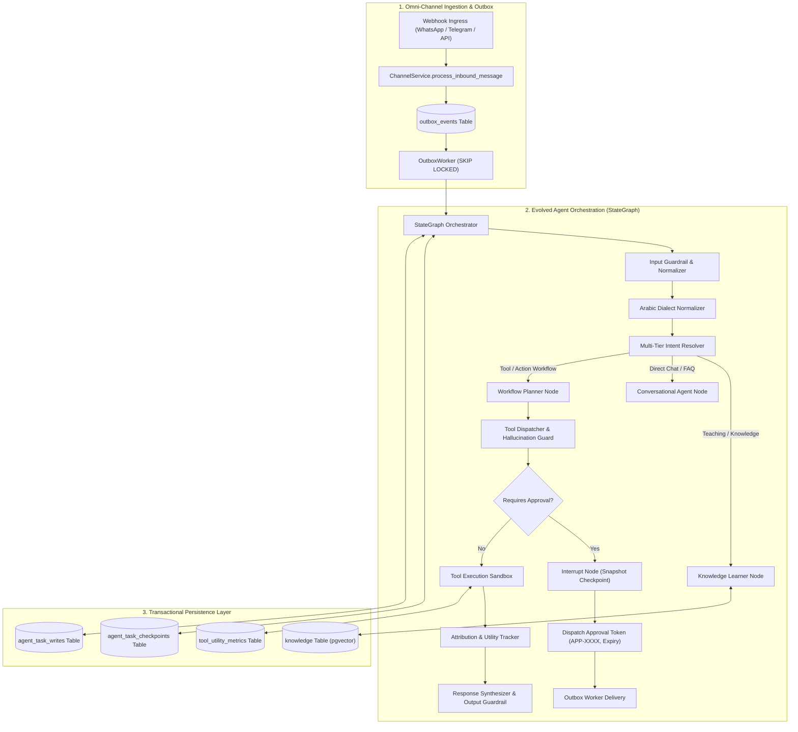
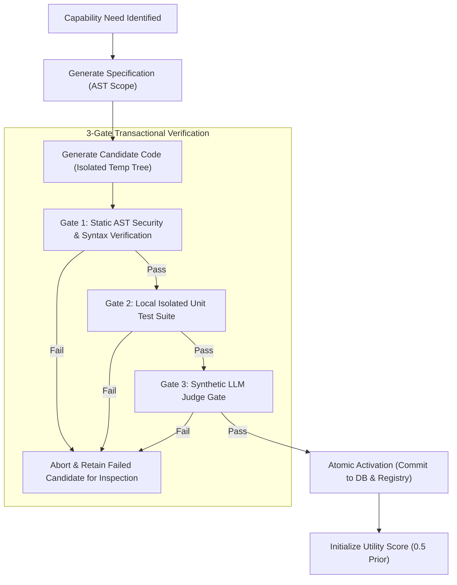

# Target Architecture Specification: The Evolved Autonomous Digital Employee (Audited)

**Authoritative Technical Specification — AI Employee Platform**  
**Repository Working Directory**: `D:\AI-Employee-Platform`  
**Audit Status**: Verified via Live Pytest Audit (`tests/test_evidence_audit_priority_risks.py`)  
**Target Milestone**: Digital Employee Autonomous Evolution  

---

## 1. Architectural Vision & Core Principles

The target architecture transforms the AI Employee Platform from an imperative, single-turn reactive assistant into an **Autonomous, State-Preserving Enterprise Digital Employee**.

The architecture adheres to four non-negotiable principles:
1. **Durable Asynchronous Autonomy**: Long-running business tasks, human approvals, and multi-turn clarifications are checkpointed transactionally in PostgreSQL, enabling pause/resume over hours or days without losing context or duplicating side effects.
2. **Deterministic Security & Approval Integrity**: High-impact or destructive actions require explicit, tamper-proof correlation tokens (`APP-XXXX`) with expiration timestamps, preventing conversational approval hijacking.
3. **Guarded Self-Evolution**: Dynamic capability generation follows a 3-gate transactional verification pipeline (AST $\rightarrow$ Local Unit Tests $\rightarrow$ Synthetic Judge) backed by atomic rollbacks and empirical utility tracking.
4. **Strict Multi-Tenant Row & Memory Isolation**: All state checkpoints, vector embeddings, tool executions, and runtime traces are bound to an authenticated `tenant_id`. Cross-tenant data leakage is structurally impossible.
5. **Zero-Dependency Native Python Stack**: No heavy third-party framework dependencies (`langchain`, `dify`, `n8n`) in production; all mechanisms are cleanly implemented in Python 3.14 / SQLAlchemy 2.0.

---

## 2. End-to-End System Architecture



---

## 3. Subsystem Specifications

### 3.1 Subsystem A: Pregel-Style StateGraph Orchestration Engine
Rather than importing heavy external runtime frameworks, the platform implements a lightweight, native Python/SQLAlchemy **StateGraph Engine** inspired by LangGraph:

#### Key Component: `StateGraph`
- **Class**: `packages.orchestration.state_graph.StateGraph`
- **Channels**: Defines explicit typed state fields:
  ```python
  class AgentExecutionState(BaseModel):
      tenant_id: UUID
      conversation_id: UUID
      thread_id: str
      checkpoint_id: str
      step: int
      incoming_message: str
      normalized_intent: str
      intent_category: str
      extracted_entities: dict[str, Any] = Field(default_factory=dict)
      active_plan: list[dict[str, Any]] = Field(default_factory=list)
      pending_interrupt: Optional[dict[str, Any]] = None
      tool_outputs: dict[str, Any] = Field(default_factory=dict)
      execution_trace_id: Optional[UUID] = None
      error_context: Optional[dict[str, Any]] = None
  ```

#### Checkpoint Tables (Database Schema)
To provide industrial durability, two new PostgreSQL tables are introduced:
1. `agent_task_checkpoints`:
   - `id`: UUID (Primary Key)
   - `tenant_id`: UUID (Indexed, Foreign Key)
   - `thread_id`: VARCHAR(128) (Indexed)
   - `checkpoint_id`: VARCHAR(128) (Indexed, unique per thread step)
   - `parent_checkpoint_id`: VARCHAR(128) (Lineage tracking)
   - `node_name`: VARCHAR(64) (Node where execution paused)
   - `state_blob`: JSONB (Complete state snapshot)
   - `status`: VARCHAR(32) (`active`, `suspended`, `completed`, `failed`)
   - `created_at`: TIMESTAMP WITH TIME ZONE
2. `agent_task_writes`:
   - `id`: UUID (Primary Key)
   - `tenant_id`: UUID
   - `thread_id`: VARCHAR(128)
   - `checkpoint_id`: VARCHAR(128)
   - `channel_name`: VARCHAR(64)
   - `write_value`: JSONB

---

### 3.2 Subsystem B: Intent & Dialect Normalization Subsystem

#### 1. `ArabicDialectNormalizer`
- **Module**: `packages.nlp.dialect_normalizer.ArabicDialectNormalizer`
- Normalizes colloquial variants across Yemeni, Saudi/Gulf, Egyptian, and Levantine dialects into canonical semantic representations:
  - **Intent Verbs**:
    - Yemeni: `اشتي`, `شتي` $\rightarrow$ `أريد` (Intent: `request_action`)
    - Saudi/Gulf: `ابغى`, `أبي`, `ودّي` $\rightarrow$ `أريد` (Intent: `request_action`)
    - Egyptian: `عايز`, `عاوز`, `نفسي` $\rightarrow$ `أريد` (Intent: `request_action`)
  - **Action Imperatives**:
    - `سوّي`, `اعملي`, `ظبط`, `جهّز` $\rightarrow$ `أنشئ / نفذ` (Action: `execute`)
    - `احذف`, `طير`, `شل` $\rightarrow$ `احذف` (Action: `delete_or_cancel`)
  - **Demonstratives & Quantifiers**:
    - `دا`, `دي`, `ذا`, `ذي` $\rightarrow$ `هذا / هذه`
    - `قوي`, `خالص`, `أوي`, `واجد`, `كتير` $\rightarrow$ `جداً`

#### 2. Multi-Tier Intent Resolver
- **Tier 1 (Deterministic Guards)**:
  - Exact approval tokens (`APP-XXXX`), security commands, system cancellations.
- **Tier 2 (Semantic Business Router)**:
  - Distinguishes between:
    1. **Business Teaching / Profile Updates**: When the owner states company info, products, prices, policies.
    2. **Operational Tool Workflows**: Inquiries about orders, inventory, customer lookup, sending campaigns.
    3. **Capability Gap / Development Requests**: Requests for features outside existing tools.
    4. **Conversational Support / FAQ**: General dialogue.
- **Tier 3 (Confidence Scoring & Clarification)**:
  - If intent confidence $< 0.85$, the agent generates a focused clarification question rather than making blind assumptions.

---

### 3.3 Subsystem C: Transactional Skill Evolution Pipeline (Adapted from Memento-Skills)



#### Verification Gates
1. **Gate 1 (AST Verification)**: Validates against `CapabilitySecurityVerifier.ALLOWED_MODULES` and ensures no `eval`, `exec`, `open`, or dunder traversal exists.
2. **Gate 2 (Local Unit Tests)**: Executes programmatic test cases with mock inputs in an isolated subprocess (`backend="subprocess"`).
3. **Gate 3 (Synthetic Judge Gate)**: Uses an LLM Judge (`SYNTHETIC_JUDGE_PROMPT`) to evaluate edge-case handling against predefined acceptance criteria.
4. **Atomic Rollback Guarantee**: If any gate fails or if runtime exceptions spike after deployment, the platform rolls back immediately to the previous `CapabilityVersion`.

#### Empirical Utility Tracking
- Database Table: `tool_utility_metrics` (`tenant_id`, `tool_slug`, `success_count`, `failure_count`, `utility_score`, `last_executed_at`).
- Scoring Formula:
  $$\text{Utility} = \frac{\text{Successes}}{\text{Successes} + \text{Failures}} \quad (\text{Default Prior} = 0.5)$$
- Tools with declining utility scores ($\text{Utility} < 0.60$) automatically trigger an autonomous optimization prompt or alert the platform administrator.

---

### 3.4 Subsystem D: Pre-Execution Hallucination Guard
- **Module**: `packages.tools.hallucination_guard.HallucinationGuard`
- When the LLM emits a tool name:
  1. Verify existence in `ToolRegistry` for the active tenant.
  2. If found, proceed to parameter schema validation (`Pydantic`).
  3. If **not found**:
     - Compute fuzzy matches using `difflib.get_close_matches(tool_name, registered_tools, n=3, cutoff=0.65)`.
     - If high-confidence match exists: reroute to the correct tool with mapped parameters.
     - If no close match exists: return structured `UNKNOWN_TOOL` status to the planner node, allowing the agent to break down the task or ask the owner for clarification without crashing.

---

### 3.5 Subsystem E: Dual-Mode Human Approval Subsystem (Adapted from RAGLeap)

#### Approval Generation Lifecycle
1. When a high-impact tool (e.g. `send_campaign`, `bulk_delete`, `order_refund > threshold`) is triggered, execution suspends:
   ```python
   approval = approval_service.create_approval(
       tenant_id=tenant_id,
       action="send_campaign",
       description="Send promotion campaign to 500 recipients",
       requested_for="tenant_owner",
       token=generate_short_token(),  # e.g. "APP-8291"
       expires_at=datetime.now(timezone.utc) + timedelta(hours=72)
   )
   ```
2. **Notification Dispatch via Outbox**:
   - Outbound channel message (WhatsApp/Telegram):
     > *"⚠️ يطلب الموظف الرقمي موافقتك لإرسال حملة ترويجية إلى 500 عميل.*  
     > *للموافقة أرسل: **موافق APP-8291***  
     > *للرفض أرسل: **رفض APP-8291***  
     > *أو اضغط للمراجعة عبر لوحة التحكم: [رابط الاعتماد]"*

3. **Resumption Path**:
   - **Via Chat**: The message is ingested, the token `APP-8291` is extracted, and verified against `Approval.token`. If valid and unexpired, `StateGraph` is resumed via `Command(resume={"approved": True})`.
   - **Via Dashboard**: The owner clicks "Approve" on the Tenant Dashboard (`POST /api/v1/approvals/APP-8291/approve`). The endpoint updates the database and enqueues a resumption event in the outbox.
   - **Zero Hijacking Guarantee**: Unrelated conversational messages saying "نعم" or "موافق" without the token are processed as normal chat and **cannot** approve the request.

---

### 3.6 Subsystem F: Dual-Tier Guardrails & Multi-Tenant Isolation

1. **Input Guardrail**:
   - Inspects inbound messages before passing to the AI Provider.
   - Strips malicious prompt injections.
   - Sanitizes sensitive PII if required by tenant configuration.
2. **Output Guardrail**:
   - Evaluates generated responses before Outbox persistence.
   - Verifies that the agent does not commit to unauthorized discounts, reveal internal prompt templates, or contradict authoritative business knowledge.
3. **Tenant Context Enforced Executor**:
   - Every tool execution is wrapped in `ToolExecutionContext(tenant_id, user_id, db_session)`.
   - Tools are barred from constructing raw queries without `tenant_id` filtering.
